<p align="center">
  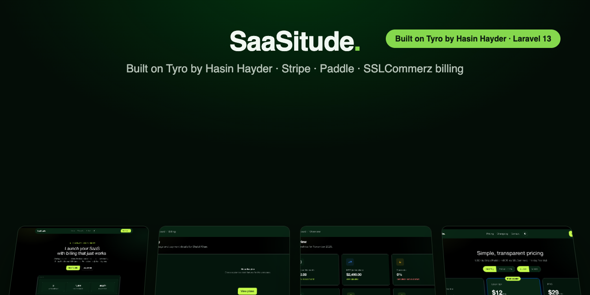
</p>

<h1 align="center">SaaSitude</h1>

<p align="center">
  <strong>Launch your SaaS with billing that just works.</strong><br>
  Workspaces · Subscriptions · Entitlements · Admin console · Mobile API.<br>
  Built on <a href="https://tyrolabs.dev">Tyro</a> by <a href="https://github.com/hasinhayder">Hasin Hayder</a> · billed via Stripe, Paddle &amp; SSLCommerz.
</p>

<p align="center">
  <a href="LICENSE"></a>
  <a href="https://laravel.com"></a>
  
  
  
  <a href="https://tyrolabs.dev"></a>
</p>

<p align="center">
  <a href="#-quick-start-60-seconds">Quick start</a> ·
  <a href="#-screenshots">Screenshots</a> ·
  <a href="#-features">Features</a> ·
  <a href="#-gateways">Gateways</a> ·
  <a href="#-mobile-api">API</a> ·
  <a href="docs/README.md">Docs</a> ·
  <a href="#-credits--gratitude">Credits</a>
</p>

---

## Why SaaSitude

Every SaaS rebuilds the same 80%: auth, teams, plans, subscriptions, invoices, webhooks, refunds, notifications, admin tooling. SaaSitude ships all of it — production-hardened, fully tested, and wrapped in a 5-step web installer — so you can spend your time on the 20% that makes your product *yours*.

- ✅ **3 payment gateways, one interface** — Stripe, Paddle (Billing, MoR tax) and SSLCommerz behind a single `PaymentGateway` contract. Swap or add gateways without touching business logic.
- ✅ **Payment state = verified webhooks only** — signature/hash verification → unique event store → queued, idempotent processing. Return URLs never grant access.
- ✅ **Workspaces are the billable entity** — every user gets a personal workspace; invite teammates with owner / admin / member / billing roles.
- ✅ **Entitlements engine** — plans and limits are *data*, not code: `Entitlements::for($workspace)->can('feature_key')`. No plan-name string checks, ever.
- ✅ **Integer money** — minor units + ISO currency (`1200, 'USD'`). No floats, anywhere.
- ✅ **Full admin console** — MRR/ARR/churn, workspace management, subscription timelines, refunds, webhook replay, gateway settings, support inbox, system health.
- ✅ **Mobile-ready API** — versioned `/api/v1` with Sanctum token abilities, workspace context, cursor pagination, idempotency keys.
- ✅ **5-step web installer** — requirements → database → admin → gateways → demo data. Clone, install, click through, done.
- ✅ **Beautiful out of the box** — [Tyro Dashboard](https://tyrolabs.dev) (shadcn variables, dark mode), plus a DB-driven public site with landing, pricing and changelog.

## 🚀 Quick start (60 seconds)

```bash
git clone https://github.com/itsmeshafat/saasitude.git saasitude
cd saasitude
composer install
npm install && npm run build
php artisan serve
```

Open **http://localhost:8000** — the installer takes over:

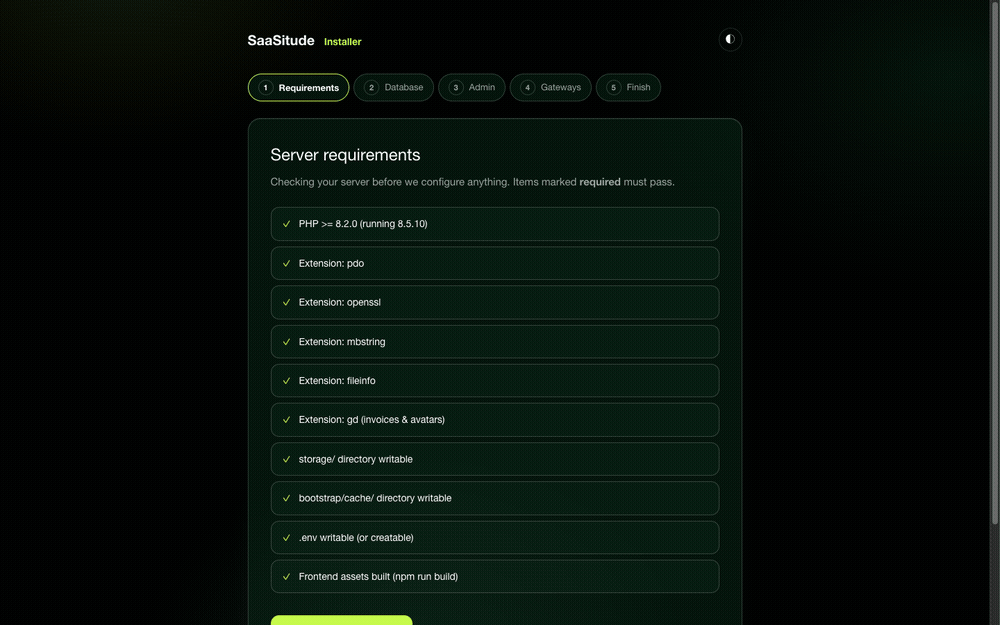

1. **Requirements** — PHP version, extensions and writable paths checked for you
2. **Database** — MySQL or SQLite; verified with a live connection, written to `.env`, migrated
3. **Admin account** — your super-admin, with a personal workspace like any registration
4. **Gateways** *(optional)* — Stripe / Paddle / SSLCommerz keys, stored encrypted; skippable
5. **Demo data** *(optional)* — one click and every screen has something to show
   (`demo@demo.com` / `password`; remove later with `php artisan saas:reset-demo`)

The installer then locks itself (`storage/app/installed.lock`) and never appears again.

<details>
<summary><strong>Prefer the terminal?</strong> Manual setup works too</summary>

```bash
cp .env.example .env
php artisan key:generate
# edit DB_* in .env
php artisan migrate --seed
php artisan tyro-dashboard:createsuperuser
```
</details>

## 📸 Screenshots

| | |
|---|---|
| 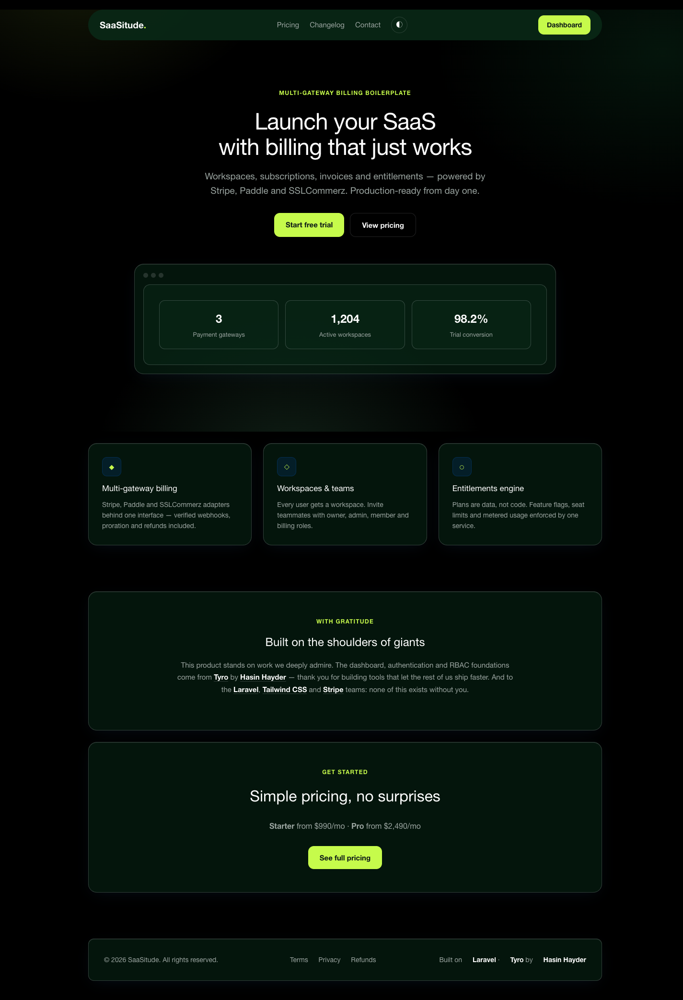 | 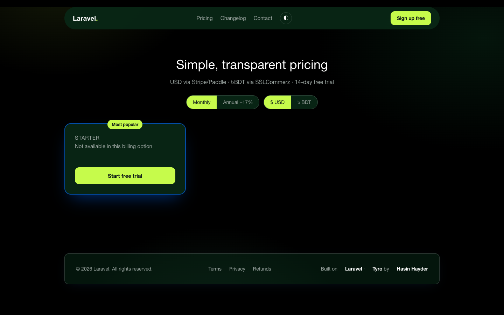 |
| *Public site — landing & DB-driven pricing* | *Monthly/annual & currency toggles* |
| 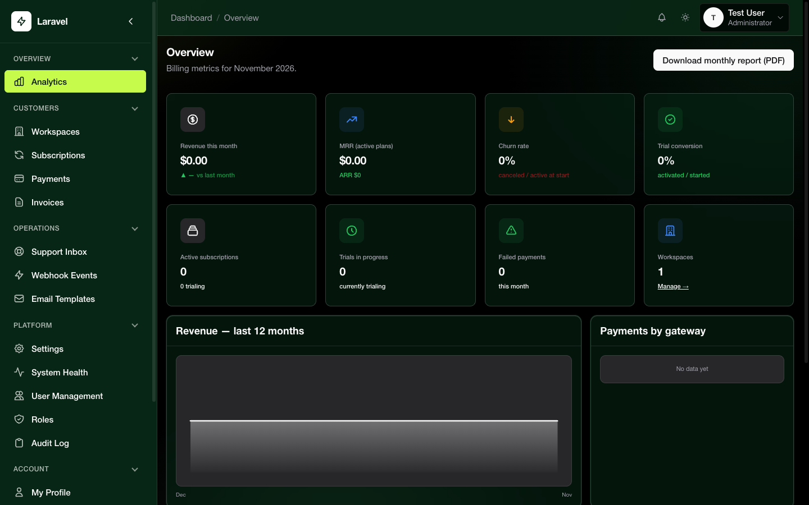 | 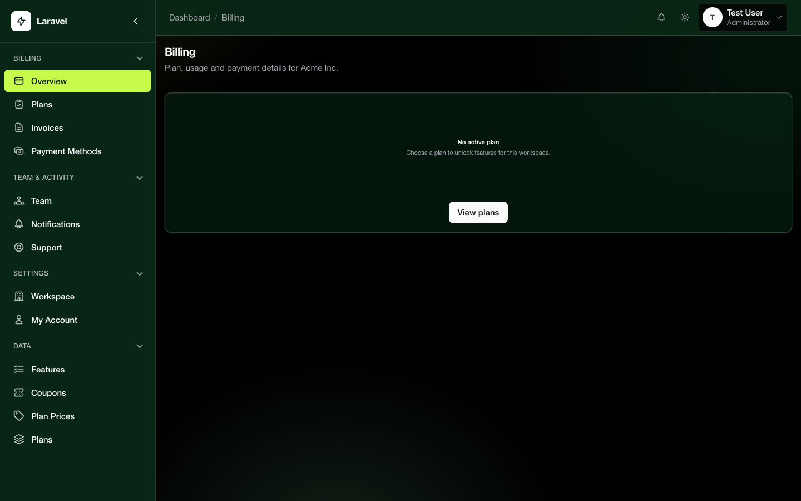 |
| *Admin console — MRR, trials, churn, failed payments* | *User billing — plan, usage meters, renewal* |
| 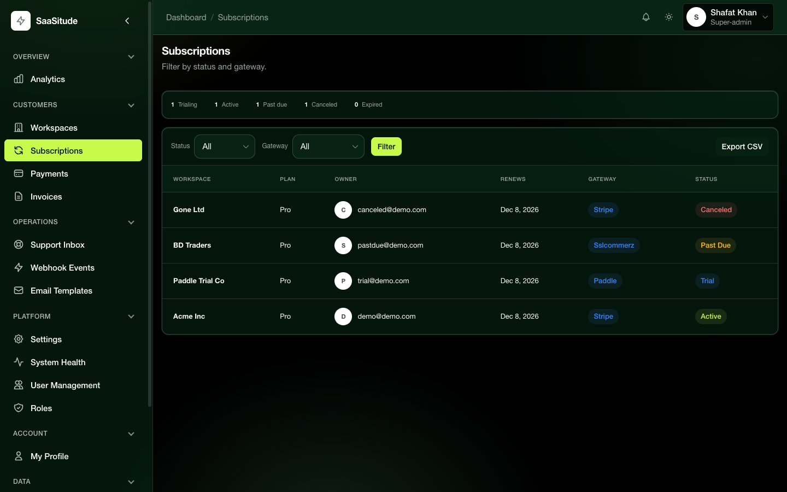 | 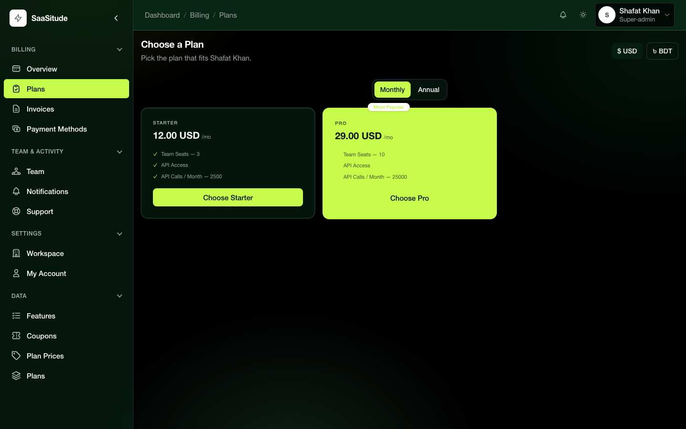 |
| *Subscriptions — filter by status/gateway, CSV export* | *Change plan with proration preview* |
| 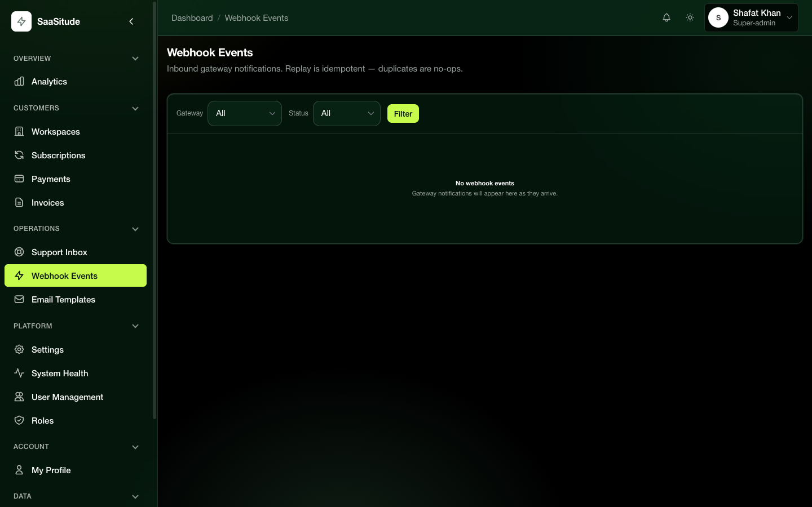 | 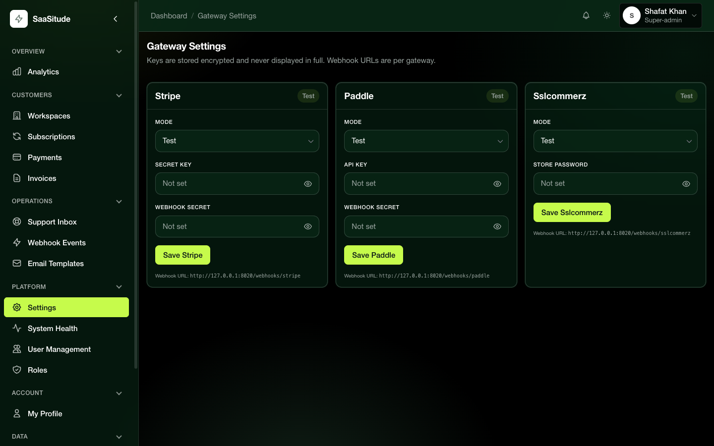 |
| *Webhook events — payload viewer + replay* | *Gateway keys — masked, encrypted, test connection* |
| 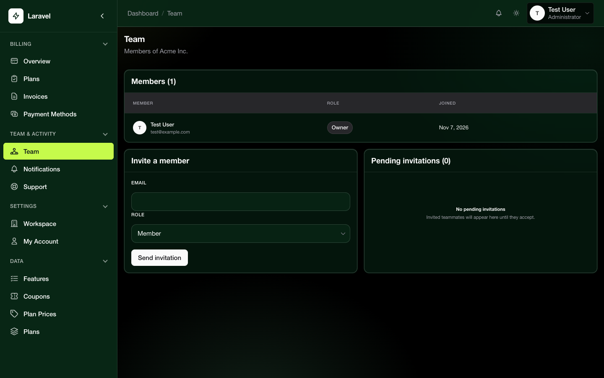 | 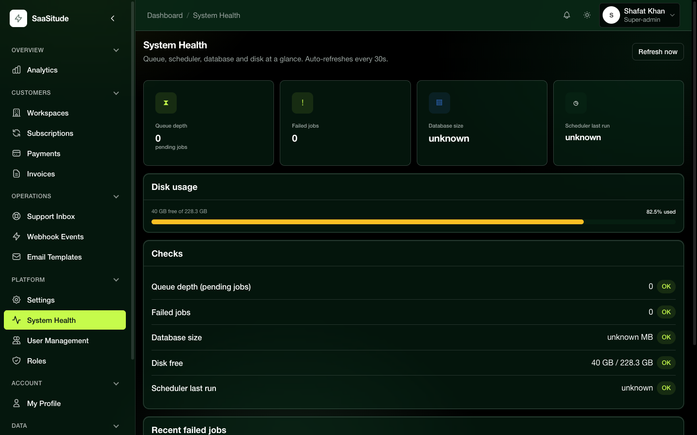 |
| *Team management — invite, roles, transfer ownership* | *System health — queues, disk, DB, scheduler* |

<details>
<summary><strong>More screens</strong> — support inbox, workspaces admin, installer steps</summary>

| | |
|---|---|
| 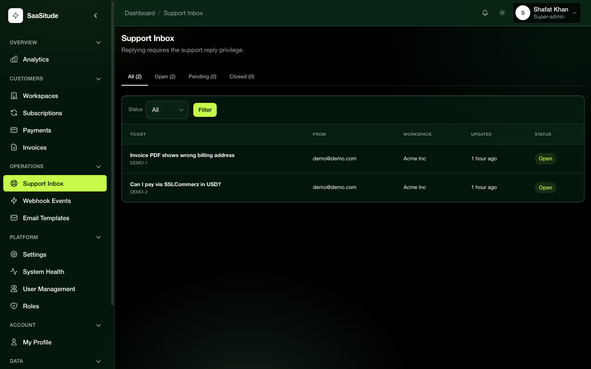 | 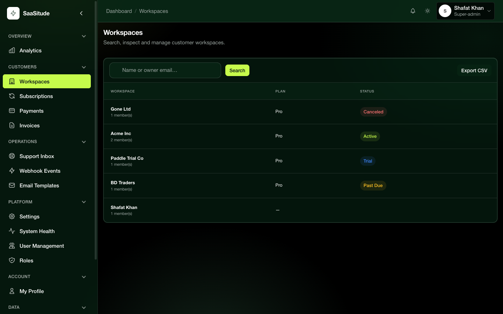 |
| *Support inbox — reply, close, audit trail* | *Workspaces — suspend, restore, force plan* |
| 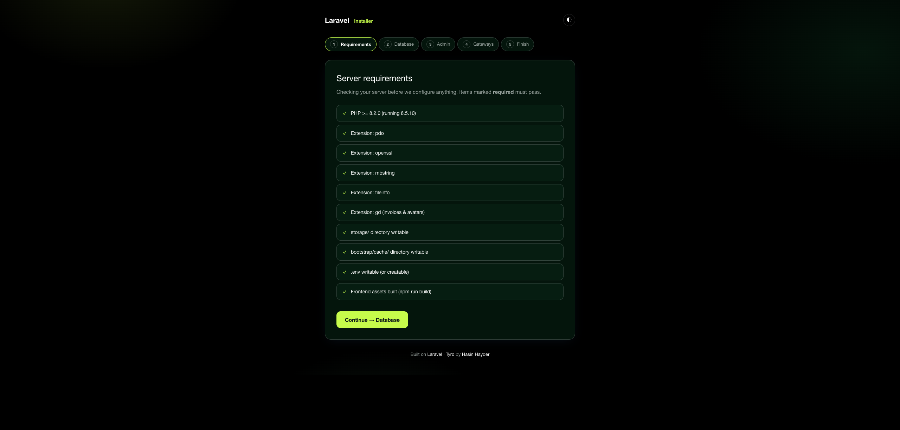 | 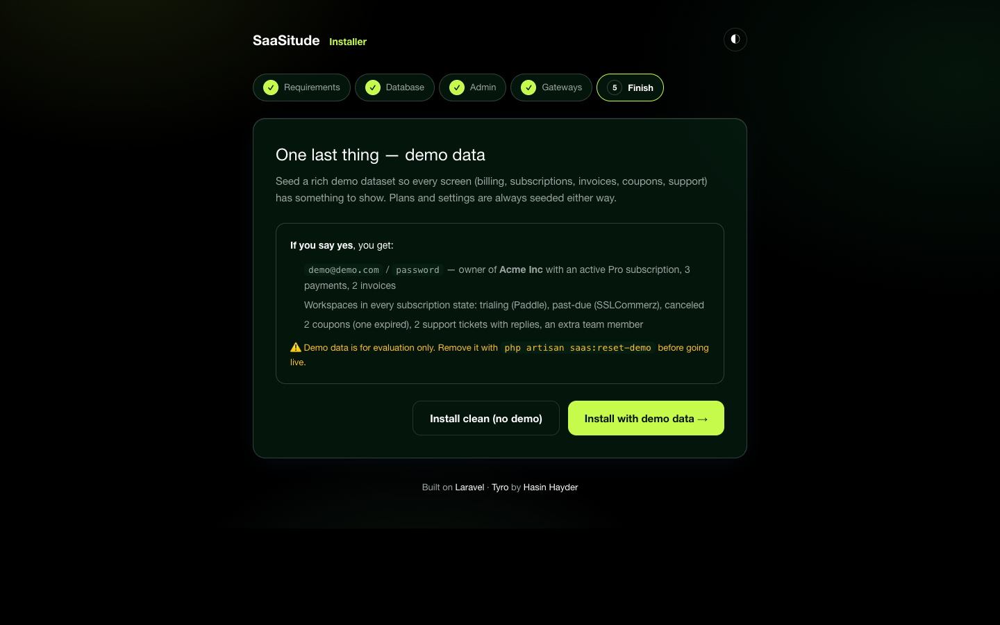 |
| *Installer — requirements check* | *Installer — optional demo dataset* |
</details>

## ✨ Features

<details open>
<summary><strong>💳 Billing core</strong></summary>

- Adapters: `StripeGateway`, `PaddleGateway`, `SSLCommerzGateway` (`app/Gateways/`)
- Subscription **state machine** with domain events (activated, payment failed, trial ending, canceled…)
- **Webhook pipeline**: verify → store (`webhook_events`, unique per gateway + event id) → queue job → idempotent replay from the admin UI
- Invoices with sequential numbers (`INV-YYYY-NNNNNN`) and PDF download
- Payments & refunds (audited, privilege-gated); coupons with redemption tracking
- App-driven renewals for SSLCommerz: 7/3/1-day reminders, grace period, auto-downgrade
</details>

<details>
<summary><strong>🏢 Workspaces &amp; teams</strong></summary>

- Personal workspace auto-created on registration (via the same `Registered` event — no forked auth)
- owner / admin / member / billing roles in `workspace_members`
- Token-based email invitations, ownership transfer, workspace switcher
</details>

<details>
<summary><strong>🔑 Plans &amp; entitlements</strong></summary>

- `plans` / `plan_prices` / `features` / `plan_features` — editable via HasCrud admin resources
- `Entitlements::for($workspace)->can($key)` / `->limit($key)` + `entitled` middleware and Blade directive
- Usage records with period counters; downgrade pre-check warns when usage exceeds the new plan
</details>

<details>
<summary><strong>🛠 Admin console</strong> — <code>/dashboard/*-admin</code></summary>

Overview metrics (MRR/ARR/churn/trials/failed payments) · Workspaces (suspend / restore / force plan / extend trial) · Subscriptions with state timelines · Payments & refunds · Invoices (regenerate PDF) · Webhook events (payload viewer + replay) · Gateway settings (masked keys, connection test) · Email template previews & test sends · Support inbox · System health · CSV/PDF exports
</details>

<details>
<summary><strong>👤 User screens</strong> — <code>/dashboard</code></summary>

Billing overview · Change plan with proration preview · Checkout (gateway selector + coupon) · Invoices & receipts · Cancel flow with reason survey · Payment methods · API keys · Notifications with preferences · Support tickets · Data export & account deletion
</details>

<details>
<summary><strong>📱 Mobile API</strong> — <code>/api/v1</code></summary>

Sanctum token abilities · `X-Workspace-Id` context header · cursor pagination · `Idempotency-Key` on payment POSTs · one error envelope `{ message, code, errors }` · covers workspaces, members, subscription lifecycle, checkout, invoices, payments, usage, devices, notifications, data rights
</details>

<details>
<summary><strong>🌐 Public site</strong></summary>

Landing page · DB-driven pricing (monthly/annual toggle) · Changelog · Contact → support inbox · Legal pages · sitemap.xml · OpenGraph tags
</details>

## 💳 Gateways

| Gateway | Checkout | Webhooks | Recurring | Refunds |
|---|---|---|---|---|
| **Stripe** | Checkout Sessions | Signed (`whsec`) | Native | ✅ |
| **Paddle** (Billing) | Overlay / hosted | Signed | Native (MoR tax) | ✅ |
| **SSLCommerz** | Hosted | IPN hash + `val_id` + amount match | App-driven (reminders + grace) | ✅ |

Configure in `.env` or via **Admin → Gateway Settings** (keys stored encrypted in the `settings` table — never in `.env`, never logged):

```env
STRIPE_SECRET=sk_test_...
STRIPE_WEBHOOK_SECRET=whsec_...
PADDLE_API_KEY=...
PADDLE_WEBHOOK_SECRET=...
SSLCOMMERZ_STORE_ID=...
SSLCOMMERZ_STORE_PASSWORD=...
```

Webhook endpoints (CSRF-exempt by design, verification is the gate):

```
POST /webhooks/stripe
POST /webhooks/paddle
POST /webhooks/sslcommerz
```

## 📱 Mobile API

```bash
curl -H "Authorization: Bearer $TOKEN" \
     -H "X-Workspace-Id: 1" \
     https://your-app.test/api/v1/workspaces/1/subscription
```

Every endpoint returns the same error envelope, payment mutations require `Idempotency-Key`, and list endpoints paginate by cursor with `ETag`/`If-None-Match` support.

## 🧪 Quality

```bash
php artisan test                                  # 182 tests, gateway fakes — no real API calls
vendor/bin/pint                                    # code style
vendor/bin/phpstan analyse --memory-limit=1G       # Larastan level 5
```

- 13 Architecture Decision Records in [`docs/adr/`](docs/adr/)
- Security headers, CSRF-scoped webhooks, encrypted secrets, full audit trail
- Every screen has empty/loading/error states; dark mode everywhere; checked at 1440px & 390px

## 📚 Documentation

| Doc | Contents |
|---|---|
| [`docs/README.md`](docs/README.md) | **Start here** — thematic index of everything |
| [`docs/01-prd.md`](docs/01-prd.md) · [`docs/02-architecture.md`](docs/02-architecture.md) | Product spec & architecture |
| [`docs/04-billing.md`](docs/04-billing.md) | Gateway rules, transactional emails |
| [`docs/adr/`](docs/adr/) | 13 ADRs — billable entity, custom billing layer, webhook idempotency, installer… |
| [`GLOSSARY.md`](GLOSSARY.md) | Domain terms |
| [`CONTRIBUTING.md`](CONTRIBUTING.md) · [`SECURITY.md`](SECURITY.md) | How to contribute & report vulnerabilities |
| [`AGENTS.md`](AGENTS.md) | Full rules for AI-assisted development |

## ❓ FAQ

<details>
<summary><strong>Why not Laravel Cashier?</strong></summary>

Cashier is excellent for single-gateway Stripe/Paddle apps. SaaSitude needs three gateways — including SSLCommerz with hash-verified IPNs and app-driven renewals — behind one interface with identical subscription state machines. That shaped <a href="docs/adr/ADR-002-custom-billing-layer.md">ADR-002: a custom billing layer</a>.
</details>

<details>
<summary><strong>Why three gateways?</strong></summary>

Global SaaS (Stripe), merchant-of-record tax handling (Paddle), and Bangladesh/local payments (SSLCommerz). One checkout UI routes by currency and availability — see <code>GatewayManager</code>.
</details>

<details>
<summary><strong>Can I add my own gateway?</strong></summary>

Implement the <code>PaymentGateway</code> interface and register it with <code>GatewayManager</code>. Checkout, webhooks and refunds follow automatically.
</details>

<details>
<summary><strong>Is it production ready?</strong></summary>

The billing core is state-machine driven with idempotent webhook processing, integer money, audit trails, 182 passing tests and Larastan level 5. Replace the placeholder plan prices in <code>config/saas-plans.php</code>, run through the gateway checklists in <code>docs/04-billing.md</code>, and have your lawyer review the legal pages.
</details>

## 🙏 Credits & gratitude

Built on the shoulders of giants — thank you:

- **[Hasin Hayder](https://github.com/hasinhayder)** for [Tyro](https://tyrolabs.dev), [Tyro Login](https://hasinhayder.github.io/tyro-login) and [Tyro Dashboard](https://github.com/hasinhayder/tyro-dashboard) — the auth, RBAC and dashboard foundations SaaSitude is built on. 💚
- The **[Laravel](https://laravel.com)**, **[Tailwind CSS](https://tailwindcss.com)**, **[shadcn](https://ui.shadcn.com)** and **[Stripe](https://stripe.com)** teams and their ecosystems.

## 💚 Sponsor

If SaaSitude saves you weeks of work, consider supporting its development:

<p align="center">
  <a href="https://www.buymeacoffee.com/itsmeshafat"></a>
  <a href="https://www.supportkori.com/itsmeshafat"></a>
</p>

Every coffee funds the next feature — more gateways, more screens, more docs. ☕

## 📄 License

MIT — see [LICENSE](LICENSE).
